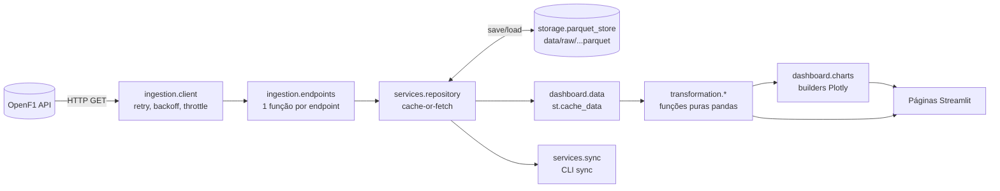

# Arquitetura

O projeto tem camadas isoladas. As regras de negócio são funções puras
(`DataFrame → DataFrame`), testáveis sem rede, sem disco e sem Streamlit.

## Módulos

| Módulo | Responsabilidade |
|---|---|
| `config.settings` | `Settings` imutável, lido de variáveis de ambiente |
| `utils.query` | `build_query()`: filtros com operadores (`date>=`), repetição e `%20` |
| `ingestion.client` | `OpenF1Client.get()`: timeout, retry em 429/5xx/rede com backoff exponencial, intervalo mínimo, 404 → `[]` |
| `ingestion.endpoints` | `Endpoint` (os 18 endpoints), `RACE_ONLY_ENDPOINTS`, `fetch_*` |
| `storage.parquet_store` | Caminhos particionados, save/load, expiração por mtime, normalização de colunas com tipos mistos |
| `services.repository` | Cache-or-fetch; TTL do calendário corrente; endpoints só de corrida são pulados fora de corridas |
| `services.sync` | Pré-carregamento de temporada/sessão (sem telemetria) |
| `transformation.calendar` | Calendário, sessões do meeting, meetings disponíveis |
| `transformation.results` | Pilotos/cores, classificação (Q1–Q3), parsing de gaps, grid x chegada, campeonato |
| `transformation.laps` | Volta mais rápida, limpeza (pit-out, nulos), outliers, setores, ritmo por stint |
| `transformation.strategy` | Linha do tempo de pneus, resumo de pit stops (`lane_duration`, `stop_duration`) |
| `transformation.positions` | Posição por volta (`merge_asof`), gaps numéricos e voltas de atraso |
| `transformation.telemetry` | Janela de tempo da volta, distância integrada, DRS, merge `car_data` x `location` |
| `transformation.context` | Clima e eventos de direção de prova (bandeiras de pista, safety car) |
| `dashboard.*` | `app.py` (navegação + barra lateral), `selection.py`, `data.py`, `charts.py`, `telemetry_charts.py`, `views/` (páginas) |

## Decisões

- **Cache imutável**: o histórico não muda, então um Parquet existente nunca é
  revalidado. Exceção: o calendário do ano corrente (TTL).
- **Telemetria sob demanda**: `car_data` e `location` (~3,7 Hz) são buscados por
  `session_key + driver_number` e pela janela `[início da volta, início da
  próxima)`, nunca em massa.
- **Tipos mistos**: campos como `gap_to_leader` misturam número e texto
  (`"+1 LAP"`). Antes de gravar, essas colunas viram texto, e as transformações
  fazem o parsing com `parse_gap`. Arrays (Q1–Q3, segmentos) voltam do Parquet
  como `ndarray`, e `as_list` normaliza.
- **Grid de largada**: a OpenF1 grava o `starting_grid` na sessão de
  classificação que o definiu (`Qualifying` para a Race, `Sprint Qualifying`
  para a Sprint), não na corrida. `grid_session_key` encontra essa sessão: a
  última do tipo `Qualifying` antes da corrida, no mesmo meeting.
- **Páginas em `views/`, não em `pages/`**: o Streamlit trata uma pasta
  `pages/` ao lado do script como multipage legado e, ao abrir a URL de uma
  página direto, a executa sem o `app.py` (sem barra lateral). As rotas vêm só
  do `st.navigation`.
- **Campos depreciados**: usa-se `lane_duration` (e não `pit_duration`, lido só
  como alternativa) e `country_code` é descartado.
- **Visualização**: a cor segue a entidade (cor oficial da equipe ou do
  composto) e o segundo piloto de cada equipe usa traço tracejado. Canais com
  escalas diferentes (telemetria, clima) ficam em painéis empilhados, nunca
  em eixos y duplos.

## Casos de borda cobertos por testes

- `lap_duration` nulo e voltas de saída dos boxes
- `gap_to_leader` como `"+N LAP(S)"` ou `null` (líder)
- `session_result.duration` como array na classificação
- `stop_duration` ausente antes do GP dos EUA de 2024
- Códigos de DRS conforme a tabela de referência (0/1, 8, 10/12/14, desconhecidos)
- Respostas 404 "No results found." da API → lista vazia
- Grid de largada da Race e da Sprint buscado na classificação correspondente
